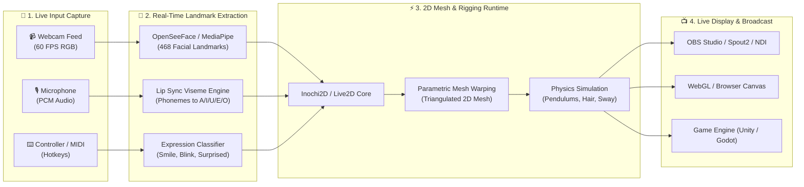

# 🎭 Awesome Real-Time 2D Character Animation 🚀

  

  
  
  
  
  
  

---

## 🌟 Overview & SEO Summary

A curated directory and engineering landscape of **Real-Time 2D Character Animation**, **Live Puppeteering**, **Webcam Facial Motion Capture (Mocap)**, **Mesh Deformation Rigging**, and **VTuber Runtimes**.

These technologies bridge digital illustration and live performance by taking continuous inputs — webcam vision streams, audio speech phonemes, or MIDI/keyboard triggers — and interpolating them in real time across parametric 2D meshes, skeletal bone rigs, and physics pendulums. Whether deploying studio-scale broadcast rigs, browser-native WebGL avatars, or self-hosted open-source VTuber pipelines, this list maps commercial standards and open-source alternatives.

---

## 📑 Table of Contents

- [📊 Sector Overview & Market Dynamics](#-sector-overview--market-dynamics)
- [🏢 SaaS & Commercial Platforms](#-saas--commercial-platforms)
- [💻 Open-Source GitHub Projects](#-open-source-github-projects)
- [🛠️ Architectural Taxonomy: How Real-Time 2D Works](#️-architectural-taxonomy-how-real-time-2d-works)
- [🤝 How to Contribute](#-how-to-contribute)
- [💖 Support & Community](#-support--community)
- [⭐ Star History](#-star-history)
- [📜 Disclaimer & License](#-disclaimer--license)

---

## 📊 Sector Overview & Market Dynamics

The global **2D animation and real-time character animation software market** is currently valued at approximately **$1.85 Billion to $2.40 Billion**, projected to surpass **$4.60 Billion by 2032** with a compound annual growth rate (CAGR) of ~8.7%. This expansion is propelled by the exponential rise of the virtual streamer (VTuber) economy, live interactive broadcasts, gaming avatars, and real-time generative digital humans.

The market displays a **moderately fragmented** dynamic characterized by distinct sub-segments rather than a pure winner-take-all monopoly:
- **Studio & Broadcast Animation**: Legacy giants like Adobe (Character Animator) and Francisco Partners / Integrated Media Technologies (Toon Boom) command high-margin professional creative suites and enterprise production workflows.
- **Anime & VTuber Rigging**: Live2D Cubism remains the entrenched commercial format standard across Japan and international gaming/streaming ecosystems.
- **Open-Source Counter-Ecosystem**: Rapidly increasing licensing costs, closed file formats, and vendor lock-in have spurred a decentralized open-source movement spearheaded by projects like Inochi2D, Open-LLM-VTuber, and OpenToonz, delivering royalty-free open runtimes for Godot, Unity, and WebAssembly.

---

## 🏢 SaaS & Commercial Platforms

The table below compiles leading commercial platforms, sorted in descending order by **Company Size (Revenue / Valuation)**.

| 🎨 Product / Platform | 🏢 Company Size (Valuation / Revenue) | ⚙️ Real-Time 2D Capabilities | 💳 Starting Tier Pricing | 🎁 Free Tier / Trial Limit | 🎯 Target Use Case |
| :--- | :--- | :--- | :--- | :--- | :--- |
| **[Adobe Character Animator](https://www.adobe.com/products/character-animator.html)** | **~$220B+ Market Cap** / **$21.4B Annual Revenue** (Adobe Inc., NASDAQ: ADBE) | • Webcam & audio-driven live puppeteering • Real-time eye gaze, blink, & viseme tracking • Adobe Creative Cloud roundtrip pipeline | **$59.99 / month** (Creative Cloud All Apps annual plan, paid monthly); or **$89.99 / month** (month-to-month); **$19.99 / mo** for Students | **7-day free trial** of full CC Pro suite; **Starter Mode is free forever** but locked to ~50 pre-built puppet templates and direct MP4 export (custom rigging & timeline editing disabled) | Professional live broadcast puppeteering, corporate explainers, and Adobe After Effects integrations |
| **[Toon Boom Harmony](https://www.toonboom.com/products/harmony)** | **~$112M Acquisition Valuation** ($147.5M CAD) / Francisco Partners parent AUM >$45B; **~$35M Annual Rev** | • High-end deformers (Envelope, Curve, Bone) • Advanced node-based rigging composites • Real-time OpenGL animation preview | **$27.00 / month** (Harmony Essentials, billed annually) or **$34.50 / month** (monthly); Advanced at **$67.50 / mo**; Premium at **$123.50 / mo** | **21-day free trial** with complete access to all toolsets across Essentials, Advanced, and Premium; exports and renders contain a visible watermark; non-commercial testing only | Feature-film, television series production, and cut-out / traditional hybrid studio pipelines |
| **[Cartoon Animator 5](https://www.reallusion.com/cartoon-animator/)** | **~$20M Annual Revenue** (Reallusion Inc., Private) | • Smart bone rigging and spring dynamics • 2D Motion LIVE webcam / iPhone facial mocap • PSD-to-puppet layered automated converter | **$149.00 one-time** perpetual workstation license (Standard); **$299.00 one-time** for Pro / Pipeline Suite; Mocap plug-in from **$99.00 one-time** | **30-day free trial** with full feature set, sample characters, and motion library; all rendered video exports are watermarked during the trial period | Indie animators, commercial video creators, and YouTube content producers wanting turn-key mocap |
| **[Live2D Cubism](https://www.live2d.com/en/)** | **~$15M Annual Revenue** (Live2D Inc., backed by Sony Music / Aniplex) | • Parametric mesh warping of layered 2D art • Physics curves, sway simulations, & eye tracking • Industry-standard `.moc3` runtime runtime | **¥1,573 / month** (~**$10.50 / mo** billed annually) or **¥2,299 / month** (~**$15.30 / mo** monthly) for Individual; Business tier at **¥7,260 / mo** (~**$48.40 / mo**) | **Free Forever Tier (Cubism FREE)**: Hard-capped at 30 art meshes, 2 deformer hierarchy depths, 2 parameters per deformer, 1 model file per project, commercial use restricted to entities <¥10M revenue; **42-day free trial** of Cubism PRO | De facto global standard for 2D VTuber avatars, mobile visual novels, and Live2D interactive game assets |
| **[VTube Studio](https://denchisoft.com/)** | **~$3M Annual Revenue** (DenchiSoft, Leading Indie Studio) | • Real-time iOS ARKit & webcam face tracking • Live2D parameter mapping with custom hotkeys • Physics-based prop attachments & hand tracking | **$14.99 one-time** DLC (VTube Studio PRO - Remove Watermark on Steam, iOS, and Android) | **Free Forever Tier**: Complete feature access including tracking algorithms, custom expressions, item drops, and OBS spout integration; displays a floating watermark mascot logo on output feed | Live VTuber streaming, interactive Twitch/YouTube broadcasts, and real-time live avatar puppeteering |

---

## 💻 Open-Source GitHub Projects

The following repositories provide open-source codebases, libraries, editors, and runtimes for real-time 2D puppet rigging, facial motion tracking, and traditional animation. **Sorted in descending order by GitHub Stars_Count**.

1. **[Open-LLM-VTuber](https://github.com/Open-LLM-VTuber/Open-LLM-VTuber)**   
   *Hands-free voice interaction, voice interruption, and Live2D 2D character avatar running locally across platforms.*  
   Integrates local LLMs, TTS engines, speech recognition, and Live2D parameter engines for autonomous, interactive, real-time 2D digital assistants and streaming companions.

2. **[live2d-widget](https://github.com/stevenjoezhang/live2d-widget)**   
   *Web-based real-time Live2D character animation widget for browser integration.*  
   Brings interactive, mouse-tracking, and scripted 2D puppets directly to web applications, blogs, and dashboards with minimal bundle size and broad model format support.

3. **[Krita](https://github.com/KDE/krita)**   
   *Professional free and open-source raster painting suite with integrated 2D frame animation timeline.*  
   Features onion skinning, audio track synchronization, raster timeline scrubbing, and high-performance brush engines. Excellent for hand-drawn frame sequences and asset prep for 2D puppets.

4. **[OpenToonz](https://github.com/opentoonz/opentoonz)**   
   *Studio-grade open-source 2D animation production software based on the legendary Toonz platform.*  
   Used extensively by Studio Ghibli. Combines traditional hand-drawn vector/raster pipelines with the "Plastic Tool" for mesh deformation, skeleton bone rigging, node-based compositing effects, and automatic line-work cleanup.

5. **[hexo-helper-live2d](https://github.com/EYHN/hexo-helper-live2d)**   
   *Seamless integration plugin for deploying interactive real-time Live2D characters into websites.*  
   Supports physics sway, customizable hit areas, touch gestures, and voice synthesis hooks across static site generators and web frontends.

6. **[EasyVTuber](https://github.com/yuyuyzl/EasyVtuber)**   
   *Real-time 2D VTuber puppeteering from single anime illustrations.*  
   Based on Talking-Head-Anime neural models and webcam computer vision. Allows creators to drive head yaw, pitch, roll, blinking, and mouth shapes instantly from a single character portrait without manual rigging.

7. **[Synfig Studio](https://github.com/synfig/synfig)**   
   *Industrial-grade open-source 2D vector animation suite with skeletal rigging.*  
   Eliminates manual frame-by-frame tweening through parametric vector interpolation. Offers a comprehensive bone rigging system, cut-out animation workflows, distortion layers, and mathematical expression linking.

8. **[OpenSeeFace](https://github.com/emilianavt/OpenSeeFace)**   
   *Robust, lightweight real-time facial landmark tracking and expression pipeline.*  
   Runs directly on CPU/GPU via regular webcams. Powers tracking backends across numerous open-source 2D/3D VTuber tools, providing high-precision eye gaze, pupil dilation, 3D head pose, and mouth visemes.

9. **[Talking Head Anime](https://github.com/pkhungurn/talking-head-anime-demo)**   
   *Real-time neural animation of 2D anime character portraits from a single static image.*  
   Uses deep learning models to warp and synthesize anime facial expressions, head rotations, and eye movements in real time based on facial tracking inputs.

10. **[Inochi2D](https://github.com/Inochi2D/inochi2d)**   
    *The reference open-source standard and runtime for real-time 2D puppet animation.*  
    Features runtime parameter-driven 2D mesh deformation, dynamic physics pendulums, real-time lighting shaders, and non-proprietary file formats. Multi-language bindings available in C (`inochi2d-c`) and Rust (`Inox2D`).

11. **[Pencil2D](https://github.com/pencil2d/pencil)**   
    *Lightweight, intuitive cross-platform traditional 2D animation app.*  
    Focuses on zero-friction hand-drawn animation with bitmap and vector drawing layers, onion skinning, and rapid keyframe sequencing. Ideal for animating sprite sheets and hand-drawn character loops.

12. **[Inochi Creator](https://github.com/Inochi2D/inochi-creator)**   
    *Official open-source GUI rigging and puppet editor for the Inochi2D ecosystem.*  
    Imports layered PSD art files, generates triangulated deformation meshes, configures physics drivers for hair/clothing sway, sets up dynamic depth layers, and exports standardized `.inp` puppet files.

13. **[Inochi Session](https://github.com/Inochi2D/inochi-session)**   
    *Real-time livestreaming and broadcast puppeteering tool for Inochi2D puppets.*  
    Connects webcam motion trackers (OpenSeeFace, VMC protocols), microphone lip-sync algorithms, and hotkeys to puppet parameters for live streaming and OBS integration.

14. **[open-vt](https://github.com/erodozer/open-vt)**   
    *Open-source desktop 2D VTuber software and runtime.*  
    Provides camera tracking, expression switching, and lightweight local rendering for creators seeking a clean, tracker-integrated alternative to commercial 2D live streaming applications.

15. **[Umamo](https://github.com/umamoorg/umamo)**   
    *Cross-platform open-source 2D puppet rigging editor.*  
    Engineered with first-class pen, tablet, and touch support. Designed as a modern, open-source alternative to proprietary rigging tools with intuitive mesh deformation tools.

16. **[Glaxnimate](https://github.com/mbasaglia/glaxnimate)**   
    *Fast vector graphics animation program with real-time preview.*  
    Supports Lottie, SVG, Rive, and vector tweening. Integrates with video editors (Kdenlive, Shotcut) to deliver real-time vector overlays and interactive animated character graphics.

17. **[ChibiRigKit](https://github.com/milkc0de/ChibiRigKit)**   
    *Browser-based single-image automated 2D rigging toolkit.*  
    Ingests a single PNG illustration and automatically partitions eye, mouth, hair, and body layers. Integrates real-time webcam face tracking, mic lip-sync, and direct OBS browser-source streaming over localhost.

---

## 🛠️ Architectural Taxonomy: How Real-Time 2D Works

---

## 🤝 How to Contribute

Contributions are warmly welcomed! Help expand this ecosystem by submitting high-quality open-source tools, runtimes, and tracking pipelines.

1. 🍴 **Fork the repository** on GitHub.
2. 🌿 **Create a new branch**: `git checkout -b feature/add-new-animation-tool`.
3. 📝 **Add your entry** to `README.md`:
   - Follow the established formatting conventions (alphabetical or star/revenue sorted).
   - Ensure specific pricing and free tier/trial limits for SaaS entries.
   - For open-source tools, include the standard stargazer social badge format.
4. 🚀 **Commit your changes**: `git commit -m "feat: add NewTool to open-source section"`.
5. 📤 **Submit a Pull Request** with a concise description of why the tool is beneficial to the real-time 2D animation community.

---

## 💖 Support & Community

If this curated repository saved you hours of research or assisted your VTuber / 2D animation pipeline, please consider supporting the project!

- ⭐ **Star this repository** to help other creators, animators, and developers discover it.
- 🍴 **Fork and share** with your local animation communities, streaming groups, and discords.
- ☕ **Sponsor the Maintainer**: Support ongoing curation, open-source tooling, and maintenance via the [GitHub Sponsor Dashboard](https://github.com/sponsors/ishandutta2007).

---

## ⭐ Star History

---

## 📜 Disclaimer & License

- **Disclaimer**: This compilation is community-curated for informational, educational, and developer reference purposes. Product names, trademarks, and logos belong to their respective copyright holders. Listed pricing and tiers reflect publicly available rates as of 2026.
- **License**: Distributed under the [MIT License](LICENSE). Listed open-source projects maintain their own respective licenses (BSD, GPL, Apache, MIT).

---

  <b>Built with ❤️ for VTubers, Animators, Riggers, and Open-Source Developers worldwide.</b>

